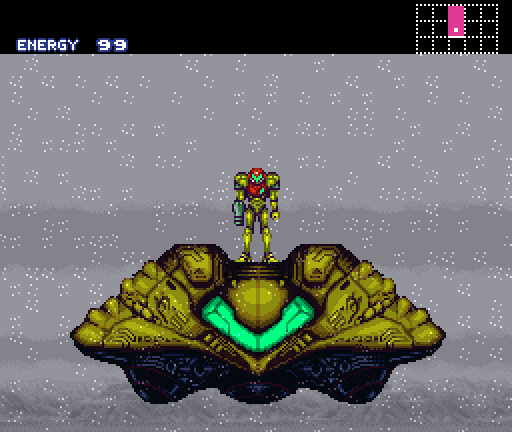
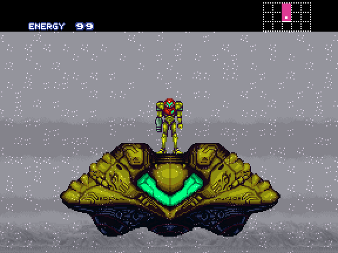
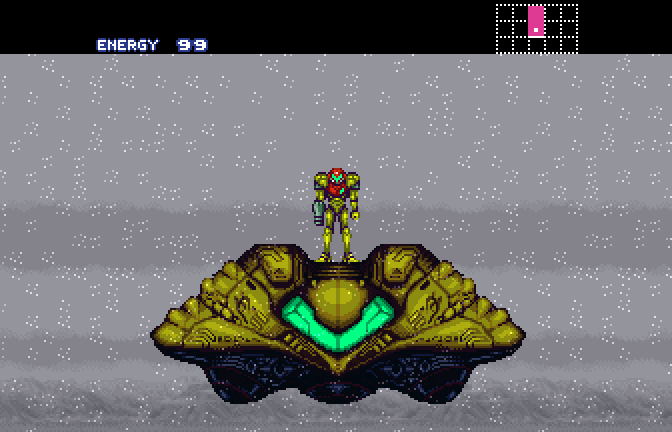
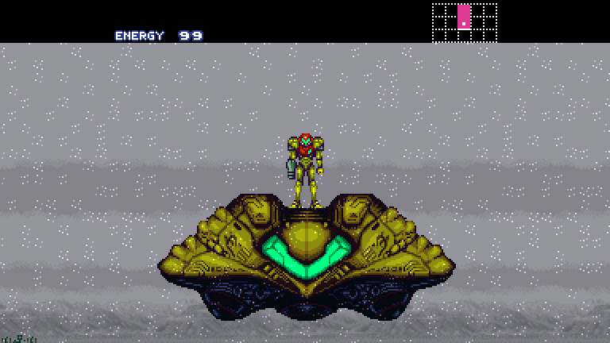
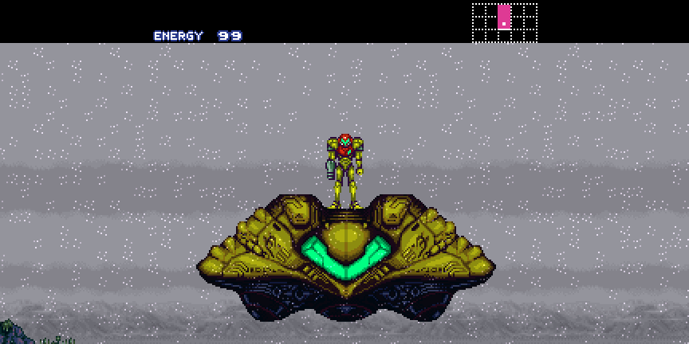
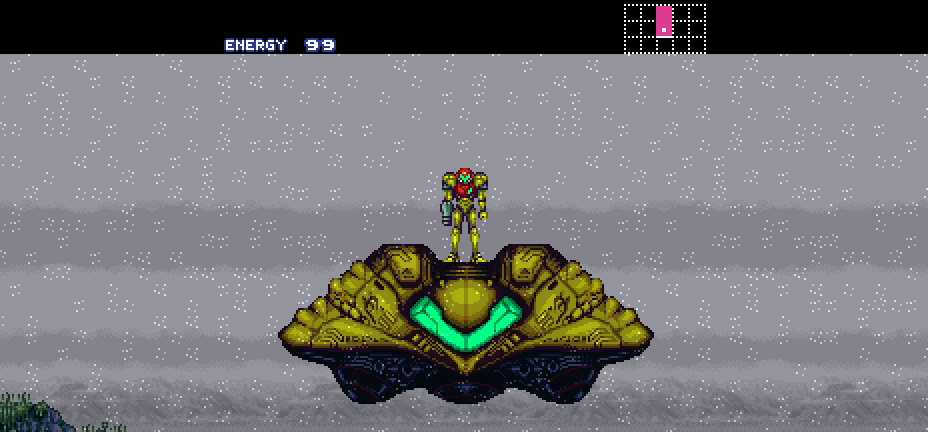
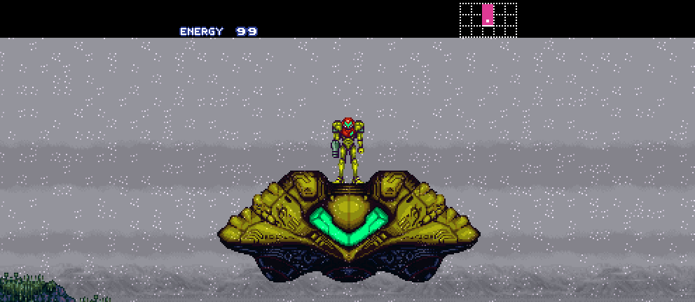
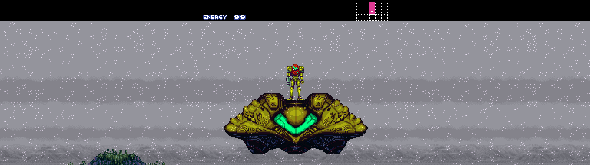

Unofficial modding done to the bsnes-hd beta 10.6 RetroArch core on Windows to allow different aspect ratios (16:9/21:9/32:9) without needing specific ROM patches.

Untested with many games, early build, expect bugs. Report any bug, gripe or changes you want done [here](https://github.com/omegamalkior/bsnes-hd/issues).

### Aspect ratios

Unmodified Super Metroid, Samus at her ship right after loading a save. The core's own output at HD scale 2x.

**Original (no widescreen)**

**4:3**

**16:10**

**16:9**

**2:1**

**19.5:9**

**21:9** (RetroArch shows it slightly wider, at 43:18, to fill 3440x1440 screens)

**32:9** (new)

### Downloads

| File | For |
| --- | --- |
| `bsnes_hd_10-7-0_windows_libretro.zip` | RetroArch on Windows (`bsnes_hd_10-7-0_libretro.dll`) |
| `bsnes_hd_10-7-0_linux_libretro.zip` | RetroArch on Linux x86-64 |
| `bsnes_hd_10-7-0_linux_arm_libretro.zip` | RetroArch on Linux ARM64 |
| `bsnes_hd_10-7-0_mac_libretro.zip` | RetroArch on macOS (Apple Silicon) |
| `bsnes_hd_10-7-0_android_libretro.zip` | RetroArch on Android (one folder per CPU type) |
| `bsnes_hd_10-7-0_3ds_libretro.zip` | Nintendo 3DS: RetroArch with this core built in (`.cia` to install, `.3dsx` for the Homebrew Launcher) |

Put the core file in RetroArch's `cores` folder and the `.info` file in its `info` folder, then pick **Widescreen - Aspect Ratio** in the core options (32:9 is new). The core keeps the bsnes-hd beta settings folder, so existing core options carry over.

### Notes

- Super Metroid (unmodified, USA) gets full widescreen with the room drawn into the extra width, up to 32:9.
- At HD scales 9x and 10x a 32:9 picture is narrowed slightly so it fits in memory.
- 3DS: works, but bsnes is far too heavy for the 3DS. Expect roughly 5 fps on an original 3DS (measured in an emulator; a New 3DS should do better but not full speed). HD Mode 7 there goes up to 2x.
